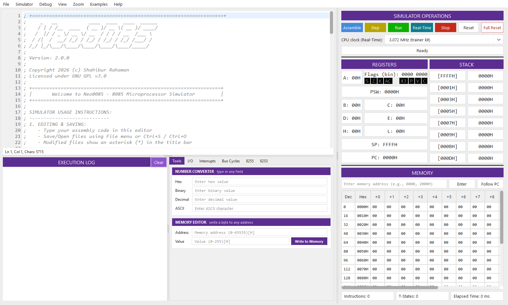
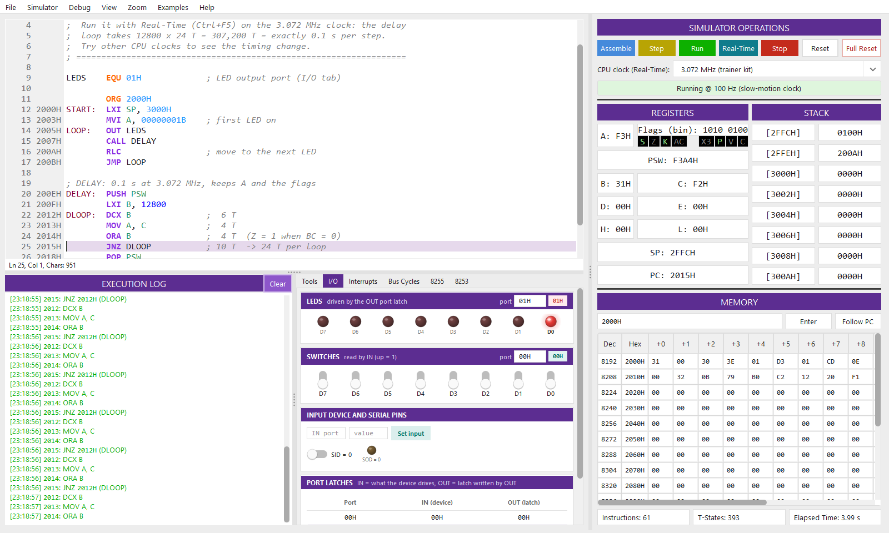
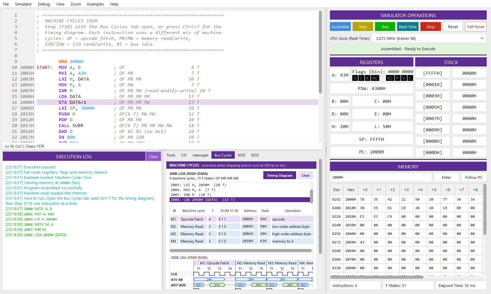
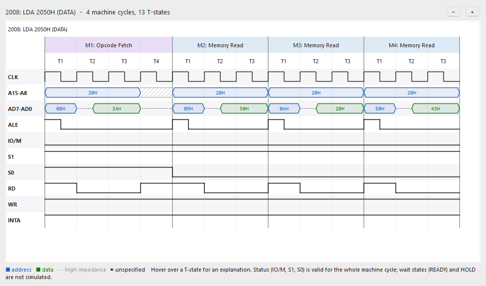
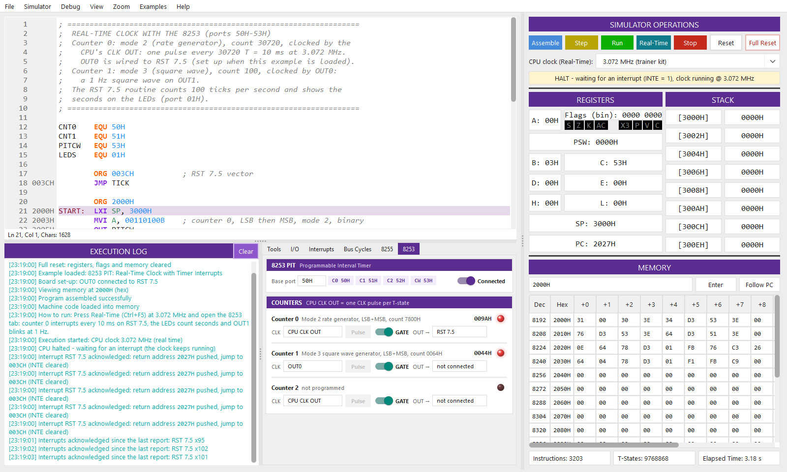
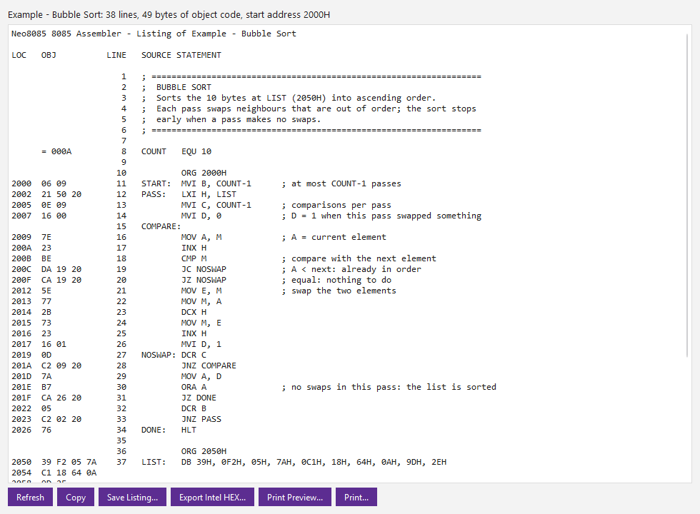

# Neo8085

<p align="center">
  
</p>

<p align="center">
  <strong>A modern 8085 microprocessor simulator with an integrated development environment</strong>
</p>

<p align="center">
  <a href="#features">Features</a> •
  <a href="#installation">Installation</a> •
  <a href="#usage">Usage</a> •
  <a href="#documentation">Documentation</a> •
  <a href="#contributing">Contributing</a> •
  <a href="#license">License</a>
</p>

---

## Overview

**Neo8085** is a comprehensive 8085 microprocessor simulator designed for educational and development purposes. It provides a modern, feature-rich environment for writing, debugging, and executing 8085 assembly language programs with real-time visualization of processor state and memory.

---

## Features

### Integrated Development Environment
- Syntax highlighting for 8085 assembly language
- Line numbers and breakpoint management
- File operations (New, Open, Save, Save As)
- Modern UI with light theme
- Zoom support (Ctrl+=, Ctrl+-, Ctrl+0)

### Intel-Compatible Assembler
- Full 8085 instruction set support: all 74 documented mnemonics plus the 10 undocumented 8085 instructions (`DSUB`, `ARHL`, `RDEL`, `LDHI`, `LDSI`, `RSTV`, `SHLX`, `LHLX`, `JNK`/`JNX5`, `JK`/`JX5`)
- Intel 8080/8085 assembly language: operator precedence, `HIGH`/`LOW`, `MOD`/`SHL`/`SHR`, relational and logical operators, binary/octal/decimal/hex and character constants, `$`
- Directives `ORG`, `EQU`, `SET`, `DB`, `DW`, `DS`, `END`, conditional assembly (`IF`/`ELSE`/`ENDIF`) and macros (`MACRO`/`ENDM`, `LOCAL`, `EXITM`, `REPT`, `IRP`, `IRPC`)
- Range checking and clear error messages with line numbers

### 8085 Execution
- Machine code is fetched and decoded from memory: self-modifying code, code written into RAM, and bytes edited in memory all execute as they would on hardware
- All 256 opcodes execute, including the 10 undocumented ones
- Flag behaviour matches the Intel 8085 (two's-complement subtraction with CY as borrow, 8085-specific AC rules for `ANA`/`ANI`, correct `DAA` BCD adjustment)
- The undocumented 8085 flags are implemented: **V** (bit 1, two's complement overflow) and **K** (bit 5, signed comparison result / `INX`-`DCX` carry); bit 3 always reads 0
- T-state (clock cycle) counting using the 8085 timing for every instruction, including taken/not-taken conditional branches and interrupt acknowledge cycles
- **Clock-driven execution**: every run mode is driven by a CPU clock locked to real time — instructions take exactly their T-states, the T-state count always equals elapsed time × clock frequency (also while the CPU waits in `HLT`), and interrupt or input changes are applied at the clock cycle at which they happen
- **Real-time mode** runs programs at the actual speed of an 8085 clocked at 3.072 MHz, so delay loops take as long as on a trainer kit

### Interrupts
- All five 8085 interrupt inputs, with the Intel 8085A interrupt structure:

| Input | Priority | Maskable by | Triggering | Vector |
|---|---|---|---|---|
| TRAP | 1 (highest) | nothing (non-maskable) | rising edge and high level, held until acknowledged | 0024H |
| RST 7.5 | 2 | EI/DI, SIM (M7.5) | rising edge, remembered in the R7.5 flip-flop | 003CH |
| RST 6.5 | 3 | EI/DI, SIM (M6.5) | high level | 0034H |
| RST 5.5 | 4 | EI/DI, SIM (M5.5) | high level | 002CH |
| INTR | 5 (lowest) | EI/DI | high level; during INTA the device supplies an instruction, usually `RST n` or `CALL addr` (any instruction except `EI`/`DI`) | from the instruction |

- Accepting any interrupt pushes the return address and clears INTE; `EI` takes effect after the following instruction (so `EI` / `RET` works); interrupts wake the CPU from `HLT`
- `SIM` sets the masks (with MSE), resets the R7.5 flip-flop (bit 4) and drives SOD; `RIM` returns SID, pending interrupts, INTE and the masks (the first `RIM` after a TRAP reports INTE as it was before the TRAP)
- RESET clears INTE, the R7.5 and TRAP flip-flops and SOD, and sets all three masks
- Interrupts are sampled in the next-to-last clock cycle of each instruction, as on the real chip: a request that arrives in an instruction's last clock is taken one instruction later. A halted CPU leaves `HLT` two T-states after the request
- Interrupt acknowledge timing: 12 T-states for TRAP and RST x.5; for INTR, the timing of the supplied instruction (12 T for `RST n`, 18 T for `CALL`)

### Peripheral Chips: 8255 PPI and 8253 PIT
Both chips sit on the I/O bus like on an 8085 trainer kit (the base port of each can be changed or the chip disconnected in its tab):

| Chip | Ports | Registers |
|---|---|---|
| 8255 PPI | 40H-43H | port A, port B, port C, control |
| 8253 PIT | 50H-53H | counter 0, counter 1, counter 2, control |

- **8255A**: modes 0, 1 (strobed input/output with STB/IBF/OBF/ACK handshake) and 2 (bidirectional port A); bit set/reset of port C; the mode 1/2 status word when reading port C; mode set clears the output latches; RESET sets all ports to mode 0 input (9BH); the control register reads as a floating bus (FFH)
- **8255 tab**: the 24 port pins (switches for input pins, lamps for pins the 8255 drives, port C bits labelled with their handshake role), STB/ACK buttons for the handshake, and INTR A / INTR B wiring to TRAP or RST 7.5/6.5/5.5
- **8253**: all six counter modes (interrupt on terminal count, retriggerable one-shot, rate generator, square wave, software and hardware strobe), binary and BCD counting, LSB/MSB/LSB-then-MSB access, the counter latch command, GATE behaviour per mode, and counts written during counting taking effect as the data sheet describes
- **8253 tab**: each counter's mode, count, live value and OUT; CLK from the CPU's CLK OUT (one pulse per T-state), CLK OUT / 2, the previous counter's OUT (cascading) or a manual pulse button; GATE switch; OUT wiring to the interrupt pins
- Exact timing: the chips are accessed in the T-state of the IN/OUT I/O machine cycle, a timer interrupt arrives at the exact T-state its OUT changes (also while the CPU waits in `HLT`), and in Step mode a `HLT` with interrupts enabled waits for the next timer interrupt
- Like the real chips, Reset (RESET OUT) resets the 8255 but not the 8253, which has no RESET input; Assemble and Full Reset power the board up again
- Examples: 8255 mode 0 with bit set/reset, an 8253 real-time clock (10 ms timer interrupts, a 1 Hz square wave from a cascaded counter) and 8255 mode 1 strobed input with interrupts

### Machine Cycles and Timing Diagrams
- Every instruction and interrupt acknowledge is broken down into its 8085 machine cycles — Opcode Fetch (4 or 6 T), Memory Read, Memory Write, I/O Read, I/O Write, Interrupt Acknowledge (INA), Bus Idle and Halt — with the address and data byte of each cycle
- **Bus Cycles tab**: a history of the recorded instructions, a table of their machine cycles (type, T-states, IO/M S1 S0 status, address, data, what the cycle does) and a T-state timing diagram
- **Timing Diagram window** (`Ctrl+T`): a large, zoomable diagram of CLK, A15–A8, AD7–AD0, ALE, IO/M, S1, S0, RD, WR and INTA; hover over a T-state for an explanation of what happens on the bus
- Bus behaviour follows the Intel 8085AH data sheet: status lines valid for the whole machine cycle, ALE in T1 (not in the bus idle cycles of `DAD`), the low address byte multiplexed on AD7–AD0 in T1, RD/WR/INTA active in T2–T3, AD7–AD0 floating in T4–T6, the I/O port address on both address halves, and the PC not incremented during INTA
- The machine cycles of every opcode (taken and not taken) add up exactly to its T-states — checked by the test suite for all 256 opcodes
- Machine cycles are recorded while stepping and in runs at 200 Hz or less; faster runs skip the recording so real-time speed is unaffected
- The diagram is at machine-cycle level: wait states (READY), HOLD/HLDA and analogue timing parameters are not simulated

| Machine cycle | IO/M | S1 | S0 | Control | T-states |
|---|---|---|---|---|---|
| Opcode Fetch | 0 | 1 | 1 | RD | 4 or 6 |
| Memory Read | 0 | 1 | 0 | RD | 3 |
| Memory Write | 0 | 0 | 1 | WR | 3 |
| I/O Read | 1 | 1 | 0 | RD | 3 |
| I/O Write | 1 | 0 | 1 | WR | 3 |
| Interrupt Acknowledge | 1 | 1 | 1 | INTA | 6 / 3 |
| Bus Idle (`DAD`) | 0 | 1 | 0 | — | 3 |
| Bus Idle (TRAP / RST x.5 acknowledge) | 1 | 1 | 1 | — | 6 |
| Halt | Z | 0 | 0 | RD, WR = Z | — |

### Input / Output
- Separate input-port and output-port latches, as on the real bus: `OUT` writes an output latch, `IN` reads the value an input device drives
- **I/O tab**: 8 LEDs on a selectable output port, 8 switches on a selectable input port, any input port value, a table of the port latches, and the `SID`/`SOD` serial pins

### Execution and Debugging
- Step-by-step execution
- Continuous execution with breakpoints
- Fast execution mode (without line highlighting)
- Real-time execution at 3.072 MHz with achieved-speed indicator
- **Reset** (8085 RESET: restart at the program start, registers and memory kept) and **Full Reset** (clear everything)
- Real-time register and flag visualization
- Memory viewer and editor
- Stack display panel for real-time stack monitoring
- Execution statistics tracking (instruction count, T-states, elapsed time)

### Opcode Listing, Intel HEX and Printing
- **Opcode Listing** (`Ctrl+L`): one click assembles the program and shows an Intel-style listing — address, object code bytes, line number and source for every line, macro/`REPT`/`IRP` expansions marked with `+`, `EQU`/`SET` values, a symbol table and a summary. Copy it, save it as a `.lst` file, preview or print it
- **Print Listing** (`Ctrl+P`): prints the listing (wrapped lines stay in the source column)
- **Export Intel HEX** (`Ctrl+E`): saves the object code as a standard Intel HEX file (16-byte data records, gaps start a new record, `:00000001FF` end record) for EPROM programmers, trainer kits and other tools. *File → Export Intel HEX with Start Address* adds a start address record for tools that use one
- **Import Intel HEX** (`Ctrl+I`): loads a HEX file, checks every record (checksum, length, digits, 64 KB limit) and turns it into source that assembles back to exactly the same bytes, ready to step and run. The code is found by following the program's jumps, calls and interrupt vectors from its start address; it is disassembled with labels at jump targets, and everything else becomes `DB` data
- The listing and export assemble the editor contents on their own, so they never disturb a program that is running or being stepped

### Advanced Tools
- Number format converter (Hex, Decimal, Binary, ASCII)
- Memory editor for direct manipulation (program code can be patched by hand, like on a trainer kit)
- Follow PC mode for automatic memory view tracking
- Detailed execution log

---

## Installation

### Option 1: Download the Installer (Recommended)

1. Go to the [Releases](https://github.com/rusty-jar/Neo8085/releases) page.
2. Download the latest installer (`.exe`) from the most recent release.
3. Run the installer and follow the on-screen instructions.
4. Launch **Neo8085** from the Start Menu or desktop shortcut.

### Option 2: Run from Source

#### Prerequisites
- Python 3.13+
- PySide6 (Qt for Python)

#### Steps

1. **Clone the repository**:
   ```bash
   git clone https://github.com/rusty-jar/Neo8085.git
   cd Neo8085
   ```

2. **Install dependencies**:
   ```bash
   pip install -r requirements.txt
   ```

3. **Run the application**:
   ```bash
   python src/main.py
   ```

### Option 3: Build the Windows Executable

After installing the dependencies (step 2 above), run:
```bat
build.bat
```
It builds `dist\Neo8085-v<version>\Neo8085.exe` with PyInstaller, with all of its files in the same folder. The version comes from `src/version.py` and is also written into the exe's file properties.

If [Inno Setup](https://jrsoftware.org/isinfo.php) 6 or 7 is installed, it also builds the installer `dist\Neo8085-Installer-v<version>.exe` from `installer.iss`. The installer asks whether to install for the current user (no administrator rights needed) or for all users, adds a Start menu shortcut (and optionally a desktop one), upgrades an earlier version in place and has an uninstaller. Neo8085 needs 64-bit Windows 10 (version 1809) or later.

### Running the Tests

```bash
python -m unittest discover -s tests
python tests/gui_audit.py
```
The unit tests need only the standard library. The GUI audit needs PySide6; it drives every menu, example, button and tab without a window and fails on any exception.

---

## Usage

### Writing Assembly Code
Use the built-in editor with syntax highlighting, line numbers, and breakpoint support.

### Examples
The **Examples** menu loads and assembles ready-made programs, each with a note in the log on how to run it:
- **Basics**: Add Two Numbers, BCD Addition (`DAA`), Multiply (shift and add), Bubble Sort, Block Copy and Checksum (subroutines and the stack)
- **I/O and Real Time**: LED Chaser (a delay loop that takes exactly 0.1 s at 3.072 MHz), Switches to LEDs (`IN`/`OUT`), Serial Output on SOD (`SIM`/`RIM`)
- **Interrupts**: an interrupt-driven counter using TRAP, RST 7.5 and INTR
- **Peripherals (8255 / 8253)**: 8255 mode 0 and bit set/reset, an 8253 real-time clock with timer interrupts, 8255 mode 1 strobed input with interrupts
- **Advanced**: Macros and Conditional Assembly, Undocumented Instructions, Machine Cycles Tour (for the Bus Cycles tab and timing diagram)

### Assembling and Execution
- **Assemble**: Click "Assemble" or press `Ctrl+B`
- **Step Execution**: Click "Step" or press `F10`
- **Continuous Execution**: Click "Run" or press `F5` — a 100 Hz slow-motion clock: every instruction is highlighted and logged and lasts as long as its T-states (4 T = 40 ms, 18 T = 180 ms)
- **Fast Execution**: Use "Run without Highlighting" or press `Ctrl+Shift+F5` — a 2 kHz clock
- In **Step** mode the clock stops between steps
- **Real-Time Execution**: Click "Real-Time" or press `Ctrl+F5` to run in real time on the clock chosen with the **CPU clock** selector; the status bar shows the achieved speed
- **CPU clock selector**: presets from 1 Hz to 1 MHz plus the clocks of real 8085 parts — 3 MHz (8085A), 3.072 MHz (trainer kit, default), 5 MHz (8085AH-2), 6 MHz (8085AH-1) — or type any value such as `250 kHz`. At 200 Hz or below every instruction is highlighted and logged. Changing the clock during a run takes effect immediately
- **Interrupts**: use the *Interrupts* tab to raise TRAP, RST 7.5, RST 6.5, RST 5.5 or INTR while the program runs (or while it waits in `HLT` with interrupts enabled)
- **I/O**: use the *I/O* tab to set the switches/input ports read by `IN` and watch the LEDs/output ports written by `OUT`
- **8255 / 8253**: program the chips with `OUT` to their ports (8255 at 40H-43H, 8253 at 50H-53H); use the *8255* and *8253* tabs to drive input pins, give handshake pulses, choose counter clocks and GATE levels, and connect chip outputs to interrupt pins
- **Reset**: "Reset" (`Ctrl+R`) restarts the program from its start address keeping registers and memory, like the RESET key of a trainer; "Full Reset" (`Ctrl+Shift+R`) clears registers, flags and all memory
- **Debugging**: Set breakpoints by clicking line numbers or pressing `F9`
- **Layout**: drag the handles between the editor, the Execution Log, the side tabs and the registers/memory panel to resize them, or drag a handle to the edge to hide a pane. The *View* menu shows or hides each pane and *Reset Layout* restores the starting layout. The pane sizes (and which panes are hidden) are remembered between sessions
- **Machine cycles**: step an instruction (or Run at 100 Hz) and open the *Bus Cycles* tab; press `Ctrl+T` for the large timing diagram. Click an earlier entry in the history to see its cycles again

### Memory Manipulation
- Use the **Memory Editor** to write values directly
- View memory contents in the **Memory View** table
- Enable **Follow PC** to track the Program Counter automatically

---

## Documentation

### Supported Instructions (All 74 Mnemonics)

**Data Transfer**: 
- Register operations: `MOV`, `MVI`
- Memory operations: `LDA`, `STA`, `LDAX`, `STAX`, `LHLD`, `SHLD` 
- Register pair operations: `LXI`, `XCHG`, `XTHL`, `SPHL`, `PCHL`

**Arithmetic**:
- Basic operations: `ADD`, `ADI`, `SUB`, `SUI`, `INR`, `DCR`
- With carry: `ADC`, `ACI`, `SBB`, `SBI`
- Register pair operations: `INX`, `DCX`, `DAD`
- BCD operations: `DAA`

**Logical**:
- Bitwise operations: `ANA`, `ANI`, `ORA`, `ORI`, `XRA`, `XRI`, `CMA`
- Comparison: `CMP`, `CPI`
- Rotation: `RLC`, `RRC`, `RAL`, `RAR`
- Flag operations: `STC`, `CMC`

**Branching**:
- Unconditional: `JMP`, `CALL`, `RET`
- Conditional jumps: `JZ`, `JNZ`, `JC`, `JNC`, `JP`, `JM`, `JPE`, `JPO`
- Conditional calls: `CZ`, `CNZ`, `CC`, `CNC`, `CP`, `CM`, `CPE`, `CPO`
- Conditional returns: `RZ`, `RNZ`, `RC`, `RNC`, `RP`, `RM`, `RPE`, `RPO`
- Restart: `RST 0-7`

**Stack Operations**:
- `PUSH`, `POP`

**I/O Operations**:
- `IN`, `OUT`

**Machine Control**:
- `HLT`, `NOP`, `EI`, `DI`, `RIM`, `SIM`

**Undocumented 8085 instructions** (all 256 opcodes execute):
- `DSUB` (08H): HL ← HL − BC, all flags affected — 10 T
- `ARHL` (10H): arithmetic shift right HL, CY ← L0, V cleared — 7 T
- `RDEL` (18H): rotate DE left through carry (CY and V affected) — 10 T
- `LDHI d8` (28H) / `LDSI d8` (38H): DE ← HL + d8 / DE ← SP + d8 — 10 T
- `RSTV` (CBH): RST to 0040H if V is set — 12/6 T
- `SHLX` (D9H) / `LHLX` (EDH): store / load HL at the address in DE — 10 T
- `JNK a16` (DDH) / `JK a16` (FDH), also written `JNX5` / `JX5`: jump if K = 0 / K = 1 — 10/7 T

### Assembler Syntax (Intel 8080/8085 Assembly Language)
- `[LABEL:] MNEMONIC [operand[, operand]] [; comment]` — spaces around commas are optional
- Names start with a letter, `?` or `@` (and may contain digits and `_`); instruction, register, directive and operator names are reserved
- Constants: decimal `25` / `25D`, hexadecimal `19H` (must start with a digit: `0FFH`), binary `11001B`, octal `31O` / `31Q`, characters `'A'` / `'AB'`, and `$` (current address)
- Operators, highest precedence first (all arithmetic is unsigned 16-bit):

| Precedence | Operators |
|---|---|
| 1 | `( )` |
| 2 | `NUL`, `HIGH`, `LOW` |
| 3 | `*`, `/`, `MOD`, `SHL`, `SHR` |
| 4 | `+`, `-` (unary and binary) |
| 5 | `EQ`, `NE`, `LT`, `LE`, `GT`, `GE` (true = `0FFFFH`) |
| 6 | `NOT` |
| 7 | `AND` |
| 8 | `OR`, `XOR` |

- `&`, `|`, `^`, `~`, `<<`, `>>` are accepted as synonyms of `AND`, `OR`, `XOR`, `NOT`, `SHL`, `SHR`
- 8-bit operands must fit in a byte (`-256` to `255`); register operands may also be expressions or `EQU` names for registers

### Assembler Directives
- `ORG expr`: Set the location counter
- `name EQU expr`: Define a constant (`name: EQU expr` is also accepted)
- `name SET expr`: Define a redefinable symbol
- `DB` / `DW`: Define bytes (numbers and strings) / 16-bit words (stored low byte first)
- `DS expr`: Reserve memory
- `END [start]`: End of the program, optionally with the start address
- `IF expr` / `ELSE` / `ENDIF`: Conditional assembly
- `name MACRO params` … `ENDM`, with `LOCAL`, `EXITM` and `&` concatenation; `REPT n`, `IRP p, <list>`, `IRPC p, chars`

> Like a real 8085, the CPU executes whatever bytes the program counter reaches. Jump over `DS` areas, otherwise the reserved bytes are executed (`00H` = `NOP`).

### Keyboard Shortcuts

| Shortcut            | Action                    |
|---------------------|---------------------------|
| Ctrl+N              | New File                  |
| Ctrl+O              | Open Program              |
| Ctrl+S              | Save                      |
| Ctrl+Shift+S        | Save As                   |
| Ctrl+L              | Opcode Listing            |
| Ctrl+P              | Print Listing             |
| Ctrl+E              | Export Intel HEX          |
| Ctrl+I              | Import Intel HEX          |
| Ctrl+B              | Assemble                  |
| F10                 | Step                      |
| F5                  | Run                       |
| Ctrl+Shift+F5       | Run without Highlighting  |
| Ctrl+F5             | Run Real-Time (3.072 MHz) |
| F8                  | Stop                      |
| Ctrl+R              | Reset (keep memory)       |
| Ctrl+Shift+R        | Full Reset                |
| F9                  | Add Breakpoint            |
| Ctrl+T              | Timing Diagram            |
| Ctrl+J              | Show/hide the lower panes (log and tabs) |
| Ctrl+Shift+J        | Show/hide the Execution Log |
| Ctrl+Shift+K        | Show/hide the side tabs   |
| Ctrl+Shift+M        | Show/hide the registers and memory panel |
| Ctrl+=              | Zoom In                   |
| Ctrl+-              | Zoom Out                  |
| Ctrl+0              | Reset Zoom                |

---

## Screenshots

<p align="center">
  
  <br/>
  <em>Neo8085 on start-up</em>
</p>

<p align="center">
  
  <br/>
  <em>A program running in slow motion, with the executed line highlighted and the LEDs on the I/O tab</em>
</p>

<p align="center">
  
  <br/>
  <em>Bus Cycles tab: the machine cycles of each instruction, with a T-state timing diagram</em>
</p>

<p align="center">
  
  <br/>
  <em>Timing diagram window (Ctrl+T)</em>
</p>

<p align="center">
  
  <br/>
  <em>The 8253 timer interrupting the CPU through RST 7.5 every 10 ms, in real time</em>
</p>

<p align="center">
  
  <br/>
  <em>Opcode listing (Ctrl+L), ready to save or print</em>
</p>

---

## Contributing

We welcome contributions to Neo8085!  
Here's how to get started:

1. Fork the repository
2. Create a new branch:
   ```bash
   git checkout -b feature-name
   ```
3. Make your changes and commit:
   ```bash
   git commit -m "Describe your changes"
   ```
4. Push to your fork:
   ```bash
   git push origin feature-name
   ```
5. Open a Pull Request

### Running the Tests
The assembler and CPU core have a test suite (standard library `unittest`, no extra dependencies) covering every opcode's encoding, timing, behaviour and machine cycles, exhaustive ALU/DAA checks, the interrupts, the 8255 and 8253, the example programs, the opcode listing and Intel HEX export/import. The CPU is also checked by differential testing against an independently written reference model of the 8085 (`tests/reference_8085.py`): both execute the same instructions from random states and must agree on every register, flag, memory byte, port and T-state:
```bash
python -m unittest discover -s tests
```

### Contribution Guidelines
- Follow existing code style and structure
- Write clear, descriptive commit messages
- Comment complex logic
- Update documentation and add tests for new features

---

## License

This project is licensed under the **GNU General Public License v3.0**.  
See the [LICENSE](LICENSE) file for details.

Intel is a trademark of Intel Corporation. Neo8085 is an independent project and is not affiliated with or endorsed by Intel.

---

## Acknowledgements

- Inspired by the Intel 8085 instruction set
- Built using [PySide6 (Qt for Python)](https://wiki.qt.io/Qt_for_Python)

---

<p align="center">
  Made with 🧠 & 💻 by Shahibur Rahaman <br/>
  Copyright &copy; 2026 Shahibur Rahaman
</p>